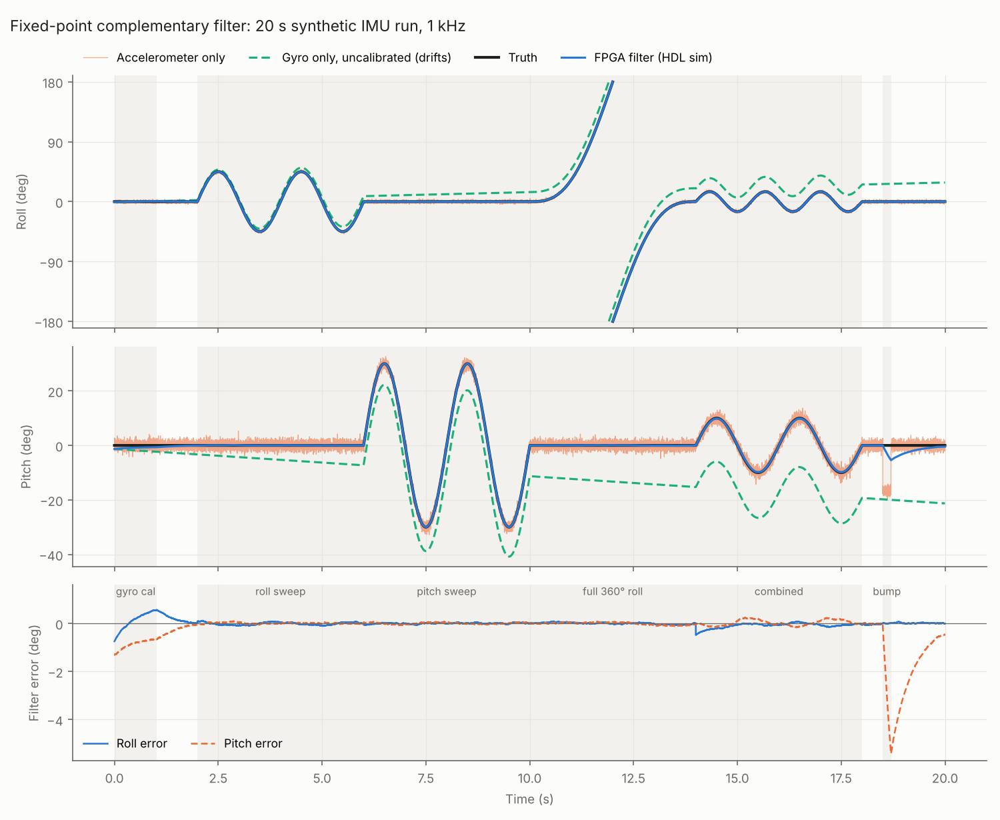
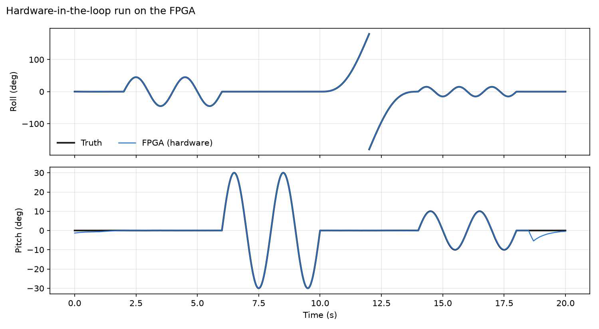
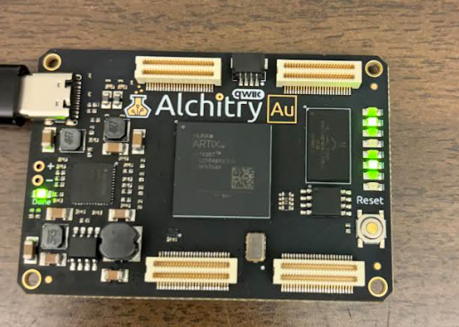

# FPGA IMU Attitude Estimator

Roll and pitch estimation in fixed-point hardware on an Alchitry Au (Xilinx Artix-7 XC7A35T).
The FPGA takes accelerometer and gyroscope samples at 1 kHz, computes tilt from the
accelerometer with a CORDIC, combines it with the gyro in a complementary filter, and sends
the angles to a PC over UART.

Status: the filter runs on the Au and matches the Python reference model bit for bit on all
20,000 test samples (hardware-in-the-loop). Timing is met at 100 MHz. Next up is a live IMU.



## Results

Simulation, 20 s synthetic IMU run. Error against ground truth in degrees:

| | Roll RMS | Roll max | Pitch RMS | Pitch max |
|---|---|---|---|---|
| Accelerometer only | 1.17 | 4.71 | 2.02 | 19.59 |
| Gyro only (no bias cal) | 16.44 | 28.71 | 12.68 | 21.29 |
| FPGA filter | 0.12 | 0.74 | 0.73 | 5.42 |

Latency is 40 clock cycles per sample (0.40 us at 100 MHz).

## On hardware

Hardware-in-the-loop run on the Au (Oct 27, 2026). `tools/hil_run.py` streams the recorded
samples to the board over USB and checks every result against the model:

```
samples sent      : 20000
results received  : 20000
bit-exact matches : 20000/20000
lost results      : 0
HIL PASS: hardware output is bit-exact with the model
```





Vivado 2026.1, post-implementation: 1,112 LUTs (5%), 871 flip-flops (2%), 3 DSP slices, no block RAM.
WNS +1.163 ns at 100 MHz.

## How it works

- One iterative CORDIC (16 iterations, no multipliers) is used twice per sample: first for
  roll = atan2(ay, az) and the magnitude, then for pitch.
- Angles are 32-bit binary angles (2^32 = 360 deg), so wrapping past +/-180 deg needs no special case.
- Filter: `pred = angle + gyro*dt`, then `angle = pred + (accel_angle - pred) >> 9`.
  Using a shift for the blend avoids a multiplier.
- Gyro bias: the first 1,024 samples are averaged and subtracted after that (hold the board
  still for about 1 s after reset). This took roll error from 0.72 to 0.12 deg.
- Timing: the first Vivado build failed at 100 MHz (WNS -1.463 ns, 14 logic levels in the filter
  update). The update is now split into pipeline stages that run while the CORDIC works on
  pitch. That added one cycle of latency and fixed timing.

## Verification

`model/fixed_model.py` is a bit-exact Python copy of the hardware and generates the expected
outputs. Four self-checking testbenches:

- `tb_cordic`: 2,733 CORDIC vectors, all quadrants and edge cases
- `tb_attitude_core`: 20,000 filter samples
- `tb_top`: full Au top level with a simulated SPI IMU, checking init writes and every UART frame
- `tb_hil`: the HIL build, including a reset, a corrupted frame and a 1% baud-rate mismatch

The tests were checked by breaking the design on purpose (a constant, a CORDIC branch, a byte
order). Each change made the tests fail.

```
cd sim && ./run_all.sh     # Icarus Verilog 12+, Python 3 with numpy and matplotlib
```

## Running on the board

1. In Vivado's Tcl console: `source <repo>/boards/alchitry_au/build_hil.tcl`
   (Vivado 2026.1 needs the free Basic Tier license).
2. Program `vivado/au_hil.bin` with the Alchitry Loader.
3. On the PC: `py tools\hil_run.py --port COM6 --plot hil_results.png`

LEDs: LED1 = gyro calibrated, LED2 = bad input frame seen, LED3 = result dropped.
`hil_run.py --selftest` runs without a board.

## Layout

```
rtl/                 design (CORDIC, filter, SPI, UART, HIL framing)
boards/alchitry_au/  top levels, pin constraints, Vivado build scripts
tb/                  testbenches and a simulated IMU
model/               Python reference model and analysis
tools/               hil_run.py, view_serial.py
```

## Next

- Live IMU over I2C on the Au's Qwiic connector (the current live build expects an SPI MPU-6500)
- Self-leveling platform driven by the filter output, for an April 2027 presentation
- Known limits: pitch is +/-90 deg only, no yaw, and sustained acceleration pulls the
  accelerometer angle
